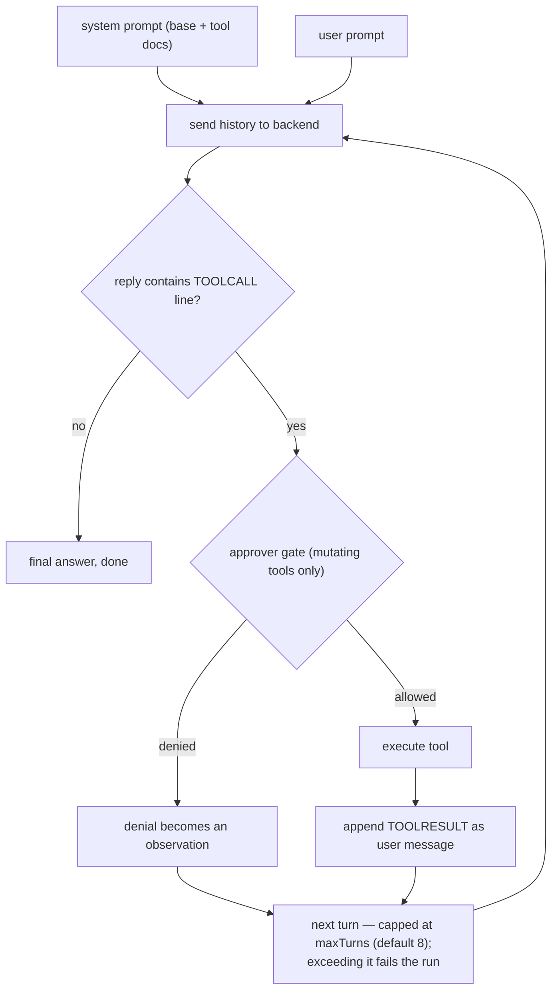
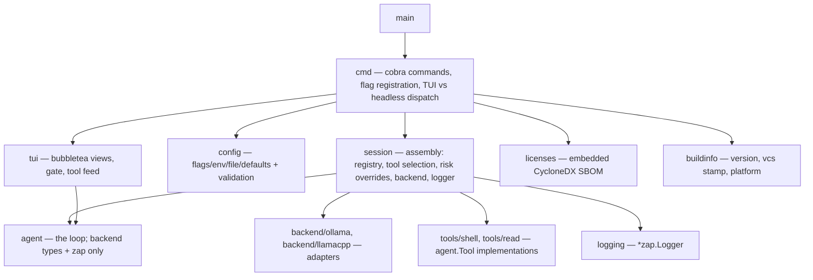

# go-reins

A minimal AI agent harness written in Go. It is a learning project
for understanding how agent tooling is built: a small agent loop that
talks to local inference backends (Ollama, llama.cpp) through a
swappable interface, with tools the operator can configure and gate.

## Agent vs. harness

- **Agent** — the LLM in a loop that decides what to do next (reason,
  act, observe, repeat).
- **Harness** — the scaffolding around it: tools, approvals, backend
  plumbing, configuration.

This project implements both, with a strict seam between them.

## Quick start

```sh
make build          # go-reins binary with a fresh SBOM embedded
./go-reins run "figure out which system you run on"
./go-reins chat     # interactive REPL: transcript, approvals, ctrl+c quits
```

With Ollama running locally, no flags are needed: the default backend
is `ollama` and the default model is `gemma4`. Every mutating tool
call asks for confirmation before it runs.

## Commands

### `run` — one task, one answer

```sh
./go-reins run "explain the CAP theorem in 3 sentences"
./go-reins run --backend llamacpp --model qwen2.5 "hello"
```

In a terminal, `run` shows a bubbletea view: a spinner while the
model works, an approval dialog (`y`/`n`) on each mutating tool
call, and the answer as the final frame. Two flags report on the
completed task: `--turns` (how many round trips it took) and
`--history` (dump the full conversation with roles, to stderr).

Piped into something else, `run` switches to the scriptable path:
the answer on stdout, prompts and diagnostics on stderr, tool
approvals as a plain `y/N` prompt on stdin — or pre-scripted:

```sh
printf 'y\ny\n' | ./go-reins run --tools shell "check disk usage and OS"
./go-reins run --yes --turns --history "what OS is this?" < /dev/null
```

### `chat` — an interactive session

```sh
./go-reins chat
```

A REPL with a scrolling transcript, a multi-line input area (enter
sends, ctrl+j inserts a newline), approval dialogs, and a status
line that shows which tool the agent is using while it works. The
conversation persists across prompts for the whole session; ctrl+c
quits. Requires a terminal.

### `licenses` — what the binary carries

```sh
./go-reins licenses
```

Lists every module the binary links against with its SPDX license
identifier. The data comes from a CycloneDX SBOM generated at build
time and embedded via `go:embed`, so the command needs no Go
toolchain and no module cache on the machine it runs on. `make
build` regenerates the document; `make check` fails when the
committed one is stale.

> **Experimental.** The licenses command and the SBOM machinery are a
> learning ground for what Go and a CLI can do — `go:embed`, build
> info, the module cache, the CycloneDX schema. Do not rely on it
> for license compliance decisions.

### `info` — how this binary was built

```sh
./go-reins info
```

Reports the release version (stamped in at build time via
`-ldflags`, `git describe` by default or `make build VERSION=1.0.0`),
the git revision and build time the Go toolchain embeds, the Go
version, and the platform.

Shell completion for bash, zsh, fish, and powershell ships with the
standard cobra `completion` command.

## Configuration

| Flag | Env | Default | Description |
| --- | --- | --- | --- |
| `--backend` | `GO_REINS_BACKEND` | `ollama` | `ollama` or `llamacpp` |
| `--model` | `GO_REINS_MODEL` | `gemma4` | model name, e.g. `gemma4` or `llama3.2` |
| `--url` | `GO_REINS_URL` | per-backend default | backend base URL (validated at startup) |
| `--yes` | `GO_REINS_YES` | `false` | auto-approve tool calls |
| `--tools` | `GO_REINS_TOOLS` | all tools | comma-separated tools to load, e.g. `read,shell`; an empty list loads none |
| `--tool-risk` | `GO_REINS_TOOL_RISK` | tool's own tier | per-tool risk override, e.g. `shell=read-only` (`read-only`, `mutating`) |
| `--log-level` | `GO_REINS_LOG_LEVEL` | `error` | log level: `debug`, `info`, `warn`, `error` (stderr) |
| `--history` | `GO_REINS_HISTORY` | `false` | print the conversation after the answer (`run` only) |
| `--turns` | `GO_REINS_TURNS` | `false` | print how many turns the run took (`run` only) |
| `--config` | — | `$HOME/.go-reins.yaml` | config file path |

Values resolve as CLI flags > environment (`GO_REINS_*`) > config
file (YAML) > defaults; a flag counts only when explicitly set, so a
file or env var can supply what the user left at its default. The
whole chain lives in `internal/config` — no viper — and the resolved
configuration is validated at load, so a bad value fails at startup
instead of mid-run.

Config file example (`~/.go-reins.yaml`):

```yaml
backend: ollama
model: llama3.2
tools: [read, shell]
tool-risk:
  shell: read-only   # sandboxed shell: no approval prompt
```

`tools` selects which tools the agent loads; `tool-risk` overrides
how the approval gate scores a tool — the operator, not the tool,
decides whether a call needs confirmation. A tool named twice, a
tool that does not exist, an override for a tool that is not
loaded: all fail at startup instead of silently changing behavior.

## Architecture

```
go-reins/
├── main.go                        # entry point, just calls cmd.Execute()
├── cmd/
│   ├── root.go                    # cobra root + persistent flag registration
│   ├── run.go                     # `go-reins run "task"`: TUI or headless
│   ├── chat.go                    # `go-reins chat`: interactive REPL
│   ├── licenses.go                # `go-reins licenses`: table from the embedded SBOM
│   ├── sbom.go                    # gen-sbom (hidden): emit the CycloneDX document
│   └── info.go                    # `go-reins info`: build provenance
└── internal/
    ├── agent/
    │   └── agent.go               # the loop + Tool, Risk, Approver, ToolObserver
    ├── backend/
    │   ├── backend.go             # the Backend interface — the swappable seam
    │   ├── http.go                # shared plumbing: PostJSON, URL validation, error bodies
    │   ├── ollama/ollama.go       # adapter: native /api/chat
    │   └── llamacpp/llamacpp.go   # adapter: OpenAI-style /v1/chat/completions
    ├── tools/
    │   ├── shell/shell.go         # mutating tool: shell command, output capped at the pipe
    │   └── read/read.go           # read-only tool: streamed file window with line numbers
    ├── config/
    │   └── config.go              # flags > env (GO_REINS_*) > YAML > defaults, + Validate
    ├── session/
    │   ├── session.go             # agent assembly: backend + logger from config
    │   └── tools.go               # tool registry, selection, risk overrides
    ├── tui/
    │   ├── approval.go            # ApprovalGate: sync Approver <-> bubbletea bridge
    │   ├── toolfeed.go             # ToolFeed: live tool status for the chat view
    │   ├── interactive.go          # Interactive: are we attached to a terminal?
    │   ├── run.go                 # run view: spinner, approval dialog, answer
    │   ├── chat.go                # chat REPL: transcript, input, approvals, tool status
    │   └── styles.go               # shared lipgloss styles
    ├── logging/
    │   └── logging.go             # zap logger setup, level from --log-level
    ├── buildinfo/
    │   └── buildinfo.go           # version, vcs revision/time, go, platform
    └── licenses/
        ├── licenses.go            # entry resolution: build info -> registry
        ├── cache.go                # module cache lookup and license file discovery
        ├── classify.go            # SPDX signature table
        └── sbom.go                # CycloneDX write/parse + the embedded sbom.json
```

### Key design decisions

- **`backend.Backend`** is the only inference contract the rest of
  the code relies on: two methods (`Name`, `Chat`). The adapters
  share one JSON round trip (`backend.PostJSON`), and both validate
  their base URL at construction, so a bad `--url` fails at startup.
  Errors carry the server's own message (`{"error":"..."}` for
  ollama, the OpenAI shape for llama.cpp), not just a status code.
- **`internal/agent`** runs a reason → act → observe loop with a
  turn cap (`WithMaxTurns`, default 8). Tool calling is a text
  protocol owned by the agent: tools are announced in the system
  prompt, the model requests one with a `TOOLCALL <name> <json>`
  line, and the observation returns as a `TOOLRESULT` user message.
  Tool errors and unknown tools become observations, so the model
  can recover instead of the run failing.
- **Risk tiers.** Every `agent.Tool` declares `agent.Risk`:
  `RiskReadOnly` tools (`read`) run without interrupting the
  operator, `RiskMutating` tools (`shell`) go through the
  `Approver`. The operator can re-score any tool per configuration
  (`--tool-risk`), so the gate is a policy, not a blanket yes/no.
- **Tool output is bounded where the bytes arrive.** `shell` caps
  at the pipe (a noisy command cannot eat memory for its timeout
  window); `read` streams the requested window, caps each line,
  and budgets the observation as rendered — prefix bytes and
  newlines included. Both honor cancellation.
- **Human in the loop.** `Approver` is a synchronous callback
  invoked from inside the agent loop, while bubbletea owns the
  terminal. The `ApprovalGate` bridges them with channels; the
  agent package never learns that a TUI exists. A denied call is
  fed back to the model as an observation.
- **`Run` is stateless**; `Step` is the session variant that takes
  an existing history and returns the extended one, which is how
  the chat REPL carries the conversation across prompts.
- **Configuration** is hand-rolled (~250 lines) with the whole
  precedence chain visible in one file, and validation at load
  time. The dependency tree stays small on purpose.

### Component seams

Every extension point is a small interface with one implementation
per variant. The agent package depends on none of the concrete
implementations — `session` wires them together:

| Seam | Interface | Implementations |
| --- | --- | --- |
| Inference | `backend.Backend` | `ollama`, `llamacpp` |
| Capability | `agent.Tool` | `tools/shell` (mutating), `tools/read` (read-only) |
| Permission | `agent.Approver` | `tui.ApprovalGate` (bubbletea), stdin prompt (headless), nil = allow |
| Progress | `agent.ToolObserver` | `tui.ToolFeed` (live tool status in chat) |
| Observability | `*zap.Logger` | `internal/logging` (no-op default) |
| Presentation | — (owns the terminal) | `tui` run view, `tui` chat REPL |

### The agent loop

One `Run` is a bounded loop of backend round trips ("turns"). The
model's reply decides how each turn ends:



Deliberate loop properties:

- **Errors are observations, not crashes.** Unknown tools, tool
  failures, and denied calls are fed back as `TOOLRESULT` text so
  the model can recover. The run itself only fails on backend
  errors or exhausting `maxTurns`.
- **The protocol is text, not native tool calling.** The agent owns
  the `TOOLCALL`/`TOOLRESULT` convention, so backends stay dumb
  message-in/message-out adapters. The trade-off: small models may
  break the format; native calling is a possible later step in the
  adapters.
- **One tool call per turn.** The first `TOOLCALL` line in a reply
  is executed; the reply is otherwise treated as final.

### Package dependencies



Dependencies point inward: `agent` knows only the `backend.Backend`
interface and its message types — never which adapter is behind it,
and never a concrete tool. `session` is the only place that
assembles concrete implementations, which is what keeps the seams
swappable.

## Requirements

- Go 1.27 or later
- A running [Ollama](https://ollama.com) server (default
  `http://localhost:11434`) or a llama.cpp server (`llama-server`,
  default `http://localhost:8080`)

## Development

```sh
make build          # build with a freshly generated SBOM embedded
make check          # gofmt gate + vet + tests + SBOM freshness (what CI runs)
make fmt            # rewrite sources in gofmt style
make test           # go test ./...
make licenses       # build, then list dependency licenses
```

`make build` also stamps a version into the binary (`go-reins info`
reports it): `git describe` output by default, or an explicit `make
build VERSION=1.0.0`.

Tests cover the agent loop (fake backend), both adapters
(`httptest` servers), the shared HTTP plumbing, config resolution
and validation, tool selection and risk overrides, both tools'
windowing/capping/boundary behavior, the TUI models, the SBOM
roundtrip, and build info extraction — so no running backend is
needed. CI ([`.github/workflows/ci.yml`](.github/workflows/ci.yml))
builds all packages and runs `make check` on every push and pull
request: the same gate locally and in CI.

## Roadmap

- [x] Tool calling: text protocol (`TOOLCALL`/`TOOLRESULT`), dispatch
      to `Tool.Execute`, observations appended to the history
- [x] Shell tool + human in the loop: approvals unless `--yes`
- [x] Bubbletea front end: run view, chat REPL, headless fallback
- [x] Hand-rolled config loader replacing viper, with load-time validation
- [x] `read` tool with risk-tiered approvals and configurable tool loading
- [x] Licenses command, embedded CycloneDX SBOM, build provenance (`info`)
- [ ] `--max-turns` flag
- [ ] Streaming responses
- [ ] `search` tool (glob + grep, read-only) and `edit` tool with
      diff approval in the TUI
- [ ] More backends (OpenAI-compatible cloud APIs)
