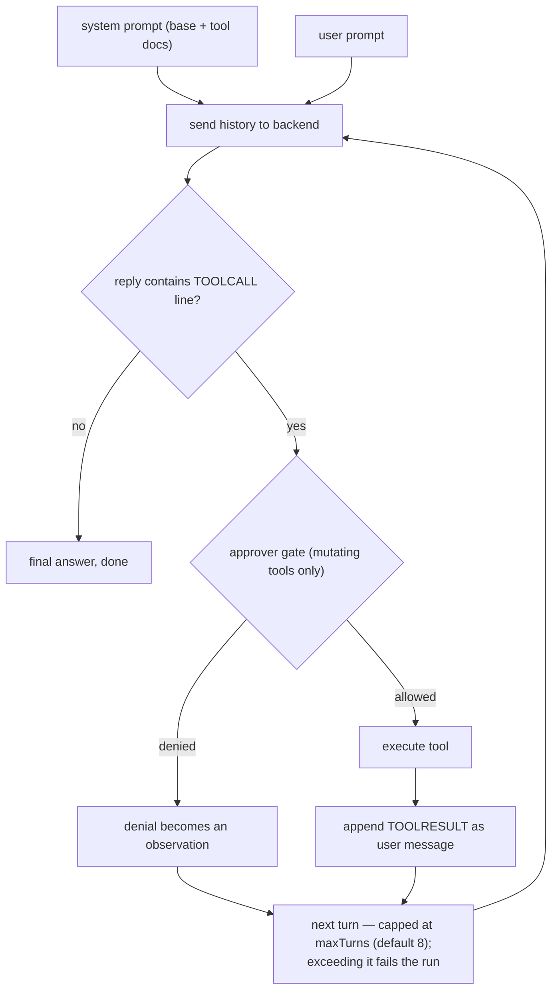
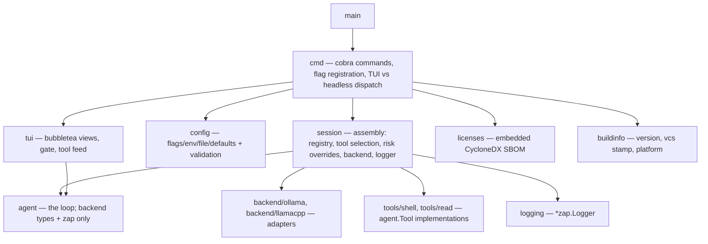

# Architecture

How go-reins is put together: the layout, the seams, the agent loop,
and what depends on what. For using the tool, see the
[README](../README.md).

```
go-reins/
├── main.go                        # entry point, just calls cmd.Execute()
├── cmd/
│   ├── root.go                    # cobra root + persistent flag registration
│   ├── run.go                     # `go-reins run "task"`: TUI or headless
│   ├── chat.go                    # `go-reins chat`: interactive REPL
│   ├── licenses.go                # `go-reins licenses`: table from the embedded SBOM
│   ├── sbom.go                    # gen-sbom (hidden): emit the CycloneDX document
│   └── info.go                    # `go-reins info`: build provenance
└── internal/
    ├── agent/
    │   └── agent.go               # the loop + Tool, Risk, Approver, ToolObserver
    ├── backend/
    │   ├── backend.go             # the Backend interface — the swappable seam
    │   ├── http.go                # shared plumbing: PostJSON, URL validation, error bodies
    │   ├── ollama/ollama.go       # adapter: native /api/chat
    │   └── llamacpp/llamacpp.go   # adapter: OpenAI-style /v1/chat/completions
    ├── tools/
    │   ├── shell/shell.go         # mutating tool: shell command, output capped at the pipe
    │   └── read/read.go           # read-only tool: streamed file window with line numbers
    ├── config/
    │   └── config.go              # flags > env (GO_REINS_*) > YAML > defaults, + Validate
    ├── session/
    │   ├── session.go             # agent assembly: backend + logger from config
    │   └── tools.go               # tool registry, selection, risk overrides
    ├── tui/
    │   ├── approval.go            # ApprovalGate: sync Approver <-> bubbletea bridge
    │   ├── toolfeed.go            # ToolFeed: live tool status for the chat view
    │   ├── interactive.go         # Interactive: are we attached to a terminal?
    │   ├── run.go                 # run view: spinner, approval dialog, answer
    │   ├── chat.go                # chat REPL: transcript, input, approvals, tool status
    │   └── styles.go              # shared lipgloss styles
    ├── logging/
    │   └── logging.go             # zap logger setup, level from --log-level
    ├── buildinfo/
    │   └── buildinfo.go           # version, vcs revision/time, go, platform
    └── licenses/
        ├── licenses.go            # entry resolution: build info -> registry
        ├── cache.go               # module cache lookup and license file discovery
        ├── classify.go            # SPDX signature table
        └── sbom.go                # CycloneDX write/parse + the embedded sbom.json
```

## Key design decisions

- **`backend.Backend`** is the only inference contract the rest of
  the code relies on: two methods (`Name`, `Chat`). The adapters
  share one JSON round trip (`backend.PostJSON`), and both validate
  their base URL at construction, so a bad `--url` fails at startup.
  Errors carry the server's own message (`{"error":"..."}` for
  ollama, the OpenAI shape for llama.cpp), not just a status code.
- **`internal/agent`** runs a reason → act → observe loop with a
  turn cap (`WithMaxTurns`, default 8). Tool calling is a text
  protocol owned by the agent: tools are announced in the system
  prompt, the model requests one with a `TOOLCALL <name> <json>`
  line, and the observation returns as a `TOOLRESULT` user message.
  Tool errors and unknown tools become observations, so the model
  can recover instead of the run failing.
- **Risk tiers.** Every `agent.Tool` declares `agent.Risk`:
  `RiskReadOnly` tools (`read`) run without interrupting the
  operator, `RiskMutating` tools (`shell`) go through the
  `Approver`. The operator can re-score any tool per configuration
  (`--tool-risk`), so the gate is a policy, not a blanket yes/no.
- **Tool output is bounded where the bytes arrive.** `shell` caps
  at the pipe (a noisy command cannot eat memory for its timeout
  window); `read` streams the requested window, caps each line,
  and budgets the observation as rendered — prefix bytes and
  newlines included. Both honor cancellation.
- **Human in the loop.** `Approver` is a synchronous callback
  invoked from inside the agent loop, while bubbletea owns the
  terminal. The `ApprovalGate` bridges them with channels; the
  agent package never learns that a TUI exists. A denied call is
  fed back to the model as an observation.
- **`Run` is stateless**; `Step` is the session variant that takes
  an existing history and returns the extended one, which is how
  the chat REPL carries the conversation across prompts.
- **Configuration** is hand-rolled (~250 lines) with the whole
  precedence chain visible in one file, and validation at load
  time. The dependency tree stays small on purpose.

## Component seams

Every extension point is a small interface with one implementation
per variant. The agent package depends on none of the concrete
implementations — `session` wires them together:

| Seam | Interface | Implementations |
| --- | --- | --- |
| Inference | `backend.Backend` | `ollama`, `llamacpp` |
| Capability | `agent.Tool` | `tools/shell` (mutating), `tools/read` (read-only) |
| Permission | `agent.Approver` | `tui.ApprovalGate` (bubbletea), stdin prompt (headless), nil = allow |
| Progress | `agent.ToolObserver` | `tui.ToolFeed` (live tool status in chat) |
| Observability | `*zap.Logger` | `internal/logging` (no-op default) |
| Presentation | — (owns the terminal) | `tui` run view, `tui` chat REPL |

## The agent loop

One `Run` is a bounded loop of backend round trips ("turns"). The
model's reply decides how each turn ends:



Deliberate loop properties:

- **Errors are observations, not crashes.** Unknown tools, tool
  failures, and denied calls are fed back as `TOOLRESULT` text so
  the model can recover. The run itself only fails on backend
  errors or exhausting `maxTurns`.
- **The protocol is text, not native tool calling.** The agent owns
  the `TOOLCALL`/`TOOLRESULT` convention, so backends stay dumb
  message-in/message-out adapters. The trade-off: small models may
  break the format; native calling is a possible later step in the
  adapters.
- **One tool call per turn.** The first `TOOLCALL` line in a reply
  is executed; the reply is otherwise treated as final.

## Package dependencies



Dependencies point inward: `agent` knows only the `backend.Backend`
interface and its message types — never which adapter is behind it,
and never a concrete tool. `session` is the only place that
assembles concrete implementations, which is what keeps the seams
swappable.
